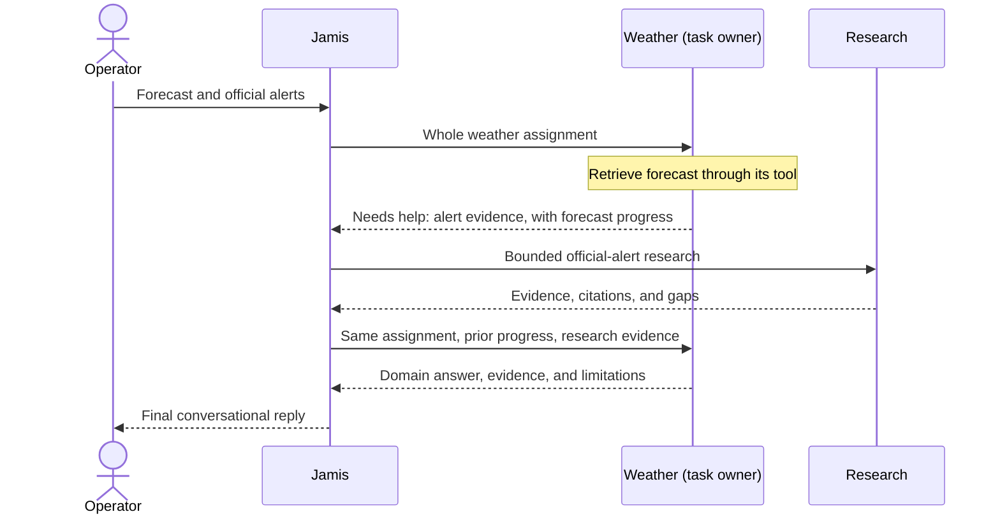
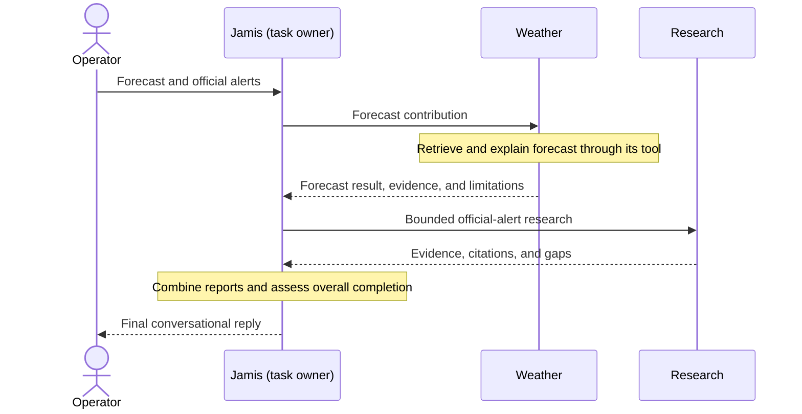
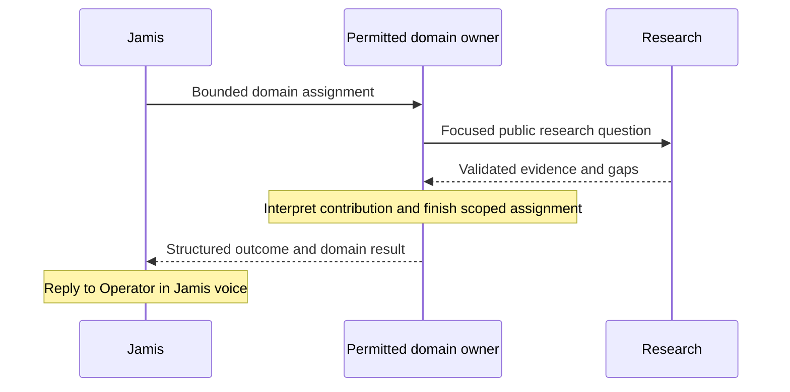

# Jamis agent architecture

Status: reviewed target design, developed through the architecture grilling session. Stage 1's isolated native boundaries are committed and deployed. Stage 2's adaptive typed delegation and bounded DM clarification are committed, pushed, and deployed through `5e3c1362dd1d74c9682c8da4f80d76ad1909c466`, with local verification/reviews and successful handset Weather/public Research smokes. Stage 2's scoped closeout is complete; the Operator's screenshot confirms the NWS source appears as a link-preview card below the reply. Live Accounts and private nested flows remain untested. Stage 3 is implemented and verified locally, with commit and push approved; stages 4 and 5 remain unstarted. See plan 029 for evidence and limits.

Delivery: [reviewed staged plan 029](plans/029-jamis-agent-architecture.md). Execution authority comes from the Operator's instructions, not from the existence of this design or plan.

Implementation checkpoint (2026-10-09 UTC): deployed Stage 2 replaces the three migrated raw delegation entries with checked invocation tools, keeps configured domain-to-Research access public-only, surfaces Calendar coverage gaps, and preserves the existing Linear proposal gate. One bounded native session-metadata slot carries public Research evidence and the original public question across an immediate clarification. Local Stage 3 also retains the original private Accounts request and actual eligible clarification answers; the slot grants no action authority. Direct API calls cannot supply that DM continuation. Direct current-request selection still relies on public-task classification and is not a general private-text sanitizer. Current-code comparisons below describe the pre-migration baseline; plan 029 records the actual local and production states. The linked-reply procedure is implemented locally in Stage 3 with retained source, publication readiness, exact outcome inspection, and a saved draft awaiting reply acceptance. Broadcast confirmation and broad Supervisor cleanup remain later stages.

> **Self-destruct after implementation:** This is a temporary working design record. During final documentation cleanup, preserve unique lasting decisions and rationale in the relevant ADRs, vocabulary in CONTEXT, and delivery/verification evidence in plan 029. Update repository references to those permanent destinations, then delete this file. Keep it until no unique design detail or active repository reference depends on it.

## Goal

Make Jamis's design simpler to extend and debug, with deterministic behavior and reliable execution. The current mega-prompt is the starting pressure point. Prompt size is useful evidence of complexity; the goal is to reduce the complexity of the whole system.

## Starting hypothesis

The Operator's [Jamis Agent Architecture draft](</Users/abdirahmanhaji/Library/Mobile Documents/27N4MQEA55~pro~writer/Documents/Jamis Agent Architecture.md>) supplies the initial role model to examine against this repository:

- Jamis owns the Operator conversation, questions, approvals, and coordination between jobs.
- Each task has one outcome owner, either Jamis or a specialist. Roles are responsibilities, not mandatory layers.
- The owner uses permitted tools, workflows, and optional capability agents directly. Delegating a contribution preserves ownership of the whole task.
- Common permission rules are authoritative and enforced in code; delegation does not expand authority. Already authorized work proceeds, while the affected action stops for missing permission, approval, or scope.
- Contracts describe scope, inputs, outputs, completion, and escalation without exposing internal process. Results preserve evidence, external effects, uncertainty, and unfinished work.

These are starting hypotheses. Direct specialist-to-Research calls were subsequently selected for the target architecture and are recorded in the 2026-10-08 design amendment to [ADR 0011](adrs/0011-jamis-online-research.md); the existing implementation still restricts Research delegation to Jamis. Memory design remains a separate discussion, as the starter draft specifies.

## Agreed requirements

- Supervisor names Jamis's existing conversation and coordination role, separate from ownership of an individual task; Jamis can also be a task owner. See the [glossary](CONTEXT.md).
- Distinguish domain specialists by subject area (for example, personal accounts and weather) and capability specialists by reusable skill (for example, research). A domain specialist can act as task owner; a capability specialist contributes focused work to that owner without taking over the overall task. Task ownership is a separate responsibility tied to an assignment's scope. See the [glossary](CONTEXT.md).
- Initially, capability specialists use only explicitly permitted tools and workflows. They return requests for help to their caller instead of delegating to other agents. Further agent delegation requires a concrete need and a separate design decision.
- Initially, domain specialists coordinate through Jamis when work needs another domain specialist. Direct domain-to-domain delegation is deferred; Jamis owns cross-domain coordination.
- Domain specialists may call Research directly when explicitly permitted by application configuration and their assigned task. Research returns its contribution to that caller, which retains ownership. This is an accepted target-design change to ADR 0011, not a claim that nested Research access is already implemented.
- Initially, handle one active conversational task at a time, with sequential delegated contributions. Concurrent tasks, a parked-task queue, and automatic background continuation are out of scope. An unrelated new request supersedes an unfinished clarification; the Operator can explicitly return to the subject later, with fresh execution and revalidated context rather than resuming an active old task.
- Jamis and permitted domain callers may form a minimal generic public research question from public labels found in account data, such as an airline and publicly named fare class, without another approval. The underlying private message, identity, booking reference, itinerary, and unrelated context must stay out of research inputs. This does not authorize private-data disclosure.
- Jamis learns a capability's purpose, required inputs, possible outcomes, and escalation conditions through its contract. Internal execution rules stay with the capability's owner.
- Every Operator-facing response uses Jamis's voice, regardless of which agent owns a task or contribution. Specialist results remain internal material for that response. Preserve supported claims, source-to-claim links, material caveats, required details, and exact proposal or quoted-draft content during composition.
- Agent restrictions must be declared and enforced in application code. Prefer Mastra's native per-agent tool and subagent configuration to expose only permitted operations and callees.
- Required human approval must prevent execution until authorized. Prompt instructions alone cannot authorize or protect an action.
- Every email send requires the Operator's explicit confirmation of that exact message and recipients. Drafting, editing, an approval for another action, or standing authorization cannot authorize sending. This is a requirement for future email sending; current Gmail access remains read-only.
- Operator-requested Fantasy broadcasts require review of the exact saved draft, followed by the same exact next-message `confirm`/`decline` interaction as Linear, bound to the Operator DM and active session. Any other reply or `/new` cancels the pending send. This accepted target behavior applies to one-off requested broadcasts; scheduled Fantasy weekly recaps retain their existing separate policy.
- Agents must have a defined way to return approval requests and work requiring help to Jamis. Jamis handles the Operator conversation and unresolved decisions.
- When a blocker reaches Jamis, it first attempts resolution within existing scope, permissions, and authorization. It asks the Operator for missing input, required approval, or a decision it cannot make; a blocked result alone does not require an Operator interruption.
- Completion and escalation use structured, code-defined signals. Code validates control inputs and governs transitions; free-form prose is answer or explanation content. A model-written status cannot grant permission or approval. Execution outcomes and approval state must be grounded in runtime evidence; task completion conditions remain contract-specific.
- Failures must be handled gracefully: preserve useful verified results, explain the affected part and any necessary next step, and never claim full completion or invent missing evidence. Partial work is useful only when it can stand independently of the failed prerequisite.

Tool availability controls which operations an agent can select. Data and argument restrictions still belong at the executable boundary. The installed Mastra approval API provides execution suspension, while presenting an approval and routing its answer on the current Sendblue channel remain application responsibilities. The result and continuation boundaries below are engineering design defaults, pending runtime acceptance rather than further choices of orchestration plumbing.

## Tool naming

Jamis-owned custom tool IDs and exposed registration names use lowercase `snake_case`, beginning with an action verb: `verb_object`. Examples: `read_file`, `write_file`, `get_forecast`, `get_current_time`, `search_web`, and `scrape_page`. Keep the custom tool ID and its explicit registration name aligned; TypeScript export identifiers retain the surrounding code's style.

Names describe the operation actually performed: use `draft_` or `propose_` for preparation, and `send_`, `create_`, or `write_` for execution. Framework/provider-owned names retain their upstream naming. These examples are illustrative and do not expand available operations or permission.

This is a project convention, not a Mastra requirement. Installed Mastra uses native names such as `ask_user` and `submit_plan`; see its [tools documentation](../node_modules/@mastra/core/dist/docs/references/docs-agents-tools.md). Existing application tool renames are deferred to implementation and must account for callers, prompts, observability mappings, and checks; no tool was renamed during this design session.

## Recommended result boundary

Use one small shared control contract with specialist-specific result content. Callers handle completion and escalation consistently; each specialist owns its domain schema and completion checks. Keep shared fields limited to those needed by concrete task walkthroughs.

This applies APOSD's simplest-interface and information-hiding guidance to the requirement for structured execution control. Ponytail favors the existing Mastra primitives and Zod validation, using source-verified framework behavior with runtime acceptance still required. Approval authority comes from runtime approval state and events, independent of a model's result content.

Use the following control contract at each specialist boundary. This is the selected engineering default, not an implemented protocol. Use a discriminated schema with only the fields permitted by its case and the specialist's own schema for result content:

| Case | Meaning and caller behavior |
| --- | --- |
| `completed` | Return the domain `result` when the scoped assignment's completion conditions are satisfied. Integrate its evidence and required details. |
| `partial` | Return a useful domain `result` and nonempty `gaps`. This ends the current attempt without claiming all requirements were met or implying background continuation. |
| `needs_help` | Return one specific `need` and optional validated `progress`. The owner needs input, a permitted contribution, or a runtime-recorded approval decision. The caller resolves what it can before escalating. |
| `blocked` | Return a safe `reason` and optional validated `progress` when the assignment has no permitted continuation within its current scope. Unsupported work and insufficient evidence are normal blocked outcomes, not invented execution errors. |
| `failed` | Application code reports this from actual execution or validation failure, retaining only independently validated progress. A model-authored failure claim cannot change runtime execution or effect records. |

Only the first four cases need to be authored by a specialist model. Execution failure uses the native error/result path and is normalized by caller code. A valid structured refusal may be `blocked` even when the agent invocation terminates normally; that does not erase any tool failure recorded in runtime evidence. Runtime decline, cancellation, and supersession are controller facts, not model-authored permission or handback tags. Keep them attached to task termination/progress and actual operation records; do not force a normal decline into `failed` or infer task completion from workflow `success`.

A `need` identifies a missing input/question, a bounded contribution request, or an existing pending operation reference. Approval-related needs must match the authoritative operation and current assignment/session before any continuation. A model cannot authorize work by returning a boolean or naming someone else's proposal. Do not include trusted task identity, permissions, approval grants, or external-effect claims in the model-authored common fields; caller code already owns those bindings.

Specialist content carries its own evidence, required answer details, and limitations. External effects and approval decisions come from validated runtime records, referenced or attached by application code; a model-authored case cannot change those facts. An unsuccessful invocation can coexist with a confirmed external effect. Caller/task identity, scope, and permission restrictions are trusted application inputs, not values a callee may widen in its handback. Avoid a general task registry or a second approval/effect ledger.

Resolved response construction: the Operator requires Jamis's voice whenever Jamis sends to the Operator. Jamis composes the conversational answer from specialist results while preserving supported claims, source-to-claim links, material caveats, required domain details, and runtime-grounded outcome. Exact proposal values and quoted artifacts, including Fantasy broadcast drafts, retain their content inside that conversation. Deterministic channel outcome and error messages should also be authored in Jamis's voice. A completed contribution does not authorize Jamis to strengthen an uncertain claim or omit a material limitation.

Resolved initial delegation scope: the Operator selected direct domain-to-Research calls with the same privacy, scope, and budget restrictions. See ADR 0011's accepted design amendment. This changes the permitted caller graph without reassigning the selected forecast-plus-alerts report from Jamis. Per-agent configuration grants explicit callees; trusted task restrictions narrow the callee's available authority. Public-only task inputs and constrained runtime context must be enforced at every Research entry point, including nested calls. Native message filtering alone is insufficient because Mastra separately shallow-copies request context. Preserve one authoritative Research policy across callers instead of copying its rules into each prompt.

### Specialist payload and completion checks

Keep the shared contract about control. Do not put all tool outputs into one universal evidence schema, or make callers understand each specialist's tools. Domain results expose the answer material, evidence, and limitations needed by the assignment. A model's `completed` case is a completion claim: code checks required evidence and runtime prerequisites before accepting it. Those checks cannot prove every interpretation or recommendation correct.

| Specialist | Required result content and boundary checks |
| --- | --- |
| Weather | Preserve the tool-resolved place, requested forecast date when applicable, relevant validated readings, and the answer/advice grounded in them. Check the place and date against the actual tool result. A missing place returns `needs_help` without a weather call; unavailable weather is never interpreted as benign conditions. Jamis preserves the existing resolved-place wording. |
| Research | Preserve supported findings, their adjacent source mappings, original URLs/titles, retrieved evidence kinds, limitations, and at most three sources. An unread candidate cannot become evidence. Insufficient evidence returns `blocked` with the existing refusal; terms-required access adds only the exact runtime-validated admin URL as access metadata. `partial` is usable only where existing source rules permit those independently supported findings, never as an escape from refusal requirements. |
| Personal Accounts | Preserve requested Gmail subject/sender/UTC date and bounded source content, Calendar calendar/title/start/end/location with its existing time conventions, and exact Linear identifiers/URLs and read status. Keep unavailable, ambiguous, denied, empty, and truncated results distinct. A posted creation proposal returns an approval-related need with runtime-bound progress; it does not complete an assignment to create an issue. A preparation-only assignment can complete when its exact proposal posting is verified. |

The current specialists return prose, not these handback schemas. Current Weather/Gmail/Calendar tools throw for some service failures; Linear and Research also return normal status/gap objects, sometimes with a recorded tool error. Preserve that distinction: a valid `blocked` or `partial` handback may accompany failed evidence retrieval. Normalize to runtime `failed` when no usable handback survives execution or validation, retaining only independently validated progress and actual operation facts. Do not manufacture useful progress from an invalid model object. Source inspection also found that Calendar currently skips selected calendars returning 403/404 without returning coverage gaps; the typed boundary must surface that missing coverage before claiming the requested window is complete, while retaining useful events from accessible calendars.

An input need carries one focused check and the missing information; a contribution need carries one bounded assignment that code checks against the permitted caller graph. An approval need identifies an operation already recorded by the action boundary. The runtime attaches or verifies that reference against the current assignment; the model cannot select a different proposal. Decline and cancellation remain runtime facts. No generic permission fields or model-authored task/effect identity are added.

### Native Mastra invocation boundary

For ordinary adaptive delegation, use a native `createTool` with a bounded assignment input and the specialist handback as its `outputSchema`. Its execution calls the existing specialist's `generate()` with `structuredOutput.schema` and strict error handling, validates the object-root `{ handback }` envelope in `response.object`, then returns the handback itself. The generation schema contains only the four model-authored cases; runtime `failed` is normalized from the native error/result path by caller code. The strict envelope keeps provider transport compatible without prose parsing or a fallback. Stage 1's bounded configured-gateway observation accepted this shape with a synthetic tool result. This is a small application integration around native primitives, not a new agent runtime, dispatcher, or workflow for every read.

Attach each invocation tool only to explicitly permitted callers. Reuse the same Research invocation boundary on Jamis and permitted domain specialists; Research has no agent callees, and domain-to-domain calls remain unavailable. Validate the trusted agent or concrete workflow caller at execution, including authenticated non-agent entry points. A model-supplied caller name is not identity. For migrated specialists, remove the parallel untyped `Agent.agents` entry during eventual implementation so there is one enforced entry path. Keep specialist instances internal and preserve Jamis's channel role. This does not rename any current tool or choose future identifiers outside the existing naming rule.

Runtime composition default, verified in installed source: configure the shared Mastra runtime first, construct internal specialists with the public `AgentConfig.mastra` constructor field, then attach public root agents and concrete workflows through `addAgent()` and `addWorkflow()`. The constructor honors the runtime field and attaches the configured logger; it does not add that specialist to the public agent registry. Do not call the explicitly internal `__registerMastra()` or `__registerPrimitives()` methods. This preserves the custom gateway and runtime services when the raw delegation entries are removed. The field is public-typed but described as automatically injected rather than illustrated as a manual composition pattern, so prove this integration before migrating routes. Preserve the existing scheduled `fantasy` registration. Attaching an internal specialist can still register its tools globally; an authenticated workflow or tool endpoint remains an executable boundary that must check its own authority.

For defined procedures, use native schema-bearing workflow steps that call this same boundary. `createStep(agent, { structuredOutput })` is also supported, but it does not perform the application context projection: use a step's `execute()` when that projection or runtime prerequisite checking is necessary. Do not duplicate the specialist policy in a workflow prompt. Account reasoning steps preparing the Linear candidate receive only the reads/preparation needed for that phase, not a tool that can publish a proposal out of order.

Direct invocation bypasses native delegation hooks, so the boundary must explicitly preserve their relevant behavior: the specialist's own instructions, pinned Research step/concurrency defaults, bounded messages, cancellation signal, and safe parent/child observability. Callers cannot supply instructions, models, toolsets, execution limits, memory/thread bindings, or request-context entries as assignment arguments. Native tool validation can return a validation-error value instead of throwing; application control must reject it rather than treating any returned object as a handback. Missing structured output also fails closed. No prose parsing, fallback success object, automatic second model, or retry is selected. The installed provider/gateway's combined tool and structured-output behavior remains an acceptance check.

Build each callee's `RequestContext` from an explicit allowlist, not a shallow copy. Research receives the public assignment and safe runtime correlation only, without account snapshots, channel objects, credentials, inherited memory, or caller capabilities. Its source contracts and request identities are created in its own context; the current source tools already reject state owned by a different context. Returning a nested Research need goes through its domain caller to Jamis; routine success returns to that caller within the current invocation. Fresh owner invocations reuse validated prior contributions, not another Research attempt to reset budgets. Existing cumulative source budgets remain instruction-level where the ADR says so; typed handback does not turn them into hard counters.

Public-only projection must constrain the explicit query as well as messages and context. For private-to-public cases, use a supported question shape and verified public labels to construct the query in code. A free-form model rewrite, a field named `public`, or a private-data denylist cannot establish publicness. If the supported projection cannot express the need safely, return the gap through Jamis without a provider call. This keeps the selected generic-public-query permission while avoiding a claim that arbitrary private-context queries can be sanitized deterministically.

## Discussed flow examples

These illustrate the proposed responsibilities; current permission definitions and ADRs remain authoritative until deliberately revised.

1. Jamis owns a task and uses permitted tools/workflows directly.
2. Jamis coordinates a whole assignment owned by a domain specialist, which uses permitted tools/workflows.
3. A domain specialist owns an assignment from Jamis and calls a permitted capability specialist for a focused contribution. The capability specialist uses its permitted tools/workflows and returns the contribution to the domain owner.
4. Jamis owns a task and calls a capability specialist for a focused contribution, then completes the task itself.
5. Jamis owns an overall task spanning domains and delegates bounded tasks to domain specialists. For example, in a plan for tomorrow, the accounts specialist owns calendar retrieval, the weather specialist owns forecasts, and Jamis owns the combined plan. Each assignment has one owner at its own scope.

The walkthroughs below settle Jamis's final voice, bounded contribution ownership for the simple combined report, and permitted direct Research calls. The control contract and approval-dependent lifecycle are specified here as engineering defaults, with runtime acceptance still required. Whole-task answer preparation stays with its owner, capability contributions are interpreted by that owner, and Jamis integrates the final conversation.

## Concrete walkthroughs

### Weather clarification and continuation

Scenario: the Operator asks, "What's the weather outside?" No unambiguous current location is available. Existing [ADR 0016](adrs/0016-weather-location-and-timing-via-checks.md) assigns location screening to the weather specialist, which must request clarification before calling a weather tool. Jamis presents the question. Neither the Operator time zone nor an old location establishes the missing place.

The structured handback identifies the missing input and preserves the original assignment. Returning a valid clarification request ends that invocation, but does not complete the weather task. On an immediately following unambiguous location answer, use a fresh invocation of the same owner with the task, relevant constraints, and supplied place. A suspended model run or general durable task engine is not justified by this read-only exchange. The typed boundary is not yet implemented or runtime-proven.

Successful handback must retain the tool's resolved place and the evidence needed for the weather answer. Jamis integrates the answer while preserving the required place wording. Invocation success, a `needs_help` clarification, and a verified `completed` assignment remain distinct.

Resolved interruption branch: Jamis asks which city, but the Operator instead asks about unread email. Serve the new request; weather is unfinished but no longer active. Do not keep it scheduled, remind automatically, or resume it in the background. The Operator may explicitly return to weather later, using fresh execution and revalidated context. Interruption and ambiguity must not silently establish a current location. The Operator excluded concurrent work at this stage.

This is separate from mutation approval. [ADR 0022](adrs/0022-confirm-linear-issue-writes-in-text.md) already cancels a pending Linear proposal on any other next message, and `/new` starts an isolated session. A conversational continuation must not revive either old approval or old-session work. The existing in-process DM queue serializes messages; it is not durable task scheduling or crash recovery.

### Calendar plus weather: partial-result branch

Scenario: the Operator asks Jamis to plan tomorrow using the calendar and weather. Jamis owns the combined assignment and obtains the two bounded contributions sequentially. The accounts specialist returns verified events; the weather service is unavailable. The calendar contribution completed, the weather contribution did not, and the parent assignment cannot claim full completion.

Resolved behavior: the Operator requires proper, graceful error handling. Return the useful verified calendar-based portion, clearly identify the unavailable forecast, and make no weather-dependent recommendation. Do not call the combined assignment complete or leave a background task pending. For example: "Here is your calendar-based plan. I couldn't retrieve the forecast, so I haven't factored weather into outdoor plans." If a failed prerequisite makes the remaining result unsafe or misleading, withhold that dependent result and explain what is missing.

### Linear creation: uncertain-effect branch

Scenario: an exact Linear creation proposal was confirmed under [ADR 0022](adrs/0022-confirm-linear-issue-writes-in-text.md), but the create response is lost. A timeout does not establish that creation failed. The existing client reports `uncertain` after a possibly sent mutation, and the durable proposal prevents replay; notification failure also must not repeat creation.

Resolved default: the Operator reiterated graceful handling. Perform one bounded read-only inspection of the proposal's preassigned issue ID within the current request, using existing read authority and no second mutation. Verified identity, pinned team, and the available proposed-operation evidence must support any confirmation. Finding the exact issue establishes that it exists; a mismatch must not be labeled successful application of the full proposal. An absent issue or failed read does not prove that the original create cannot still complete. Unresolved effects remain uncertain and require inspection before another attempt. No polling, background reconciliation, or general retry engine is proposed. The inspection is proposed architecture behavior, not an existing implementation claim.

### Approval followed by remaining work

Scenario: "Turn this email into a Linear issue, then draft a reply linking the new issue." This requests one issue creation and a text draft, not an email send. The exact create proposal still uses ADR 0022's next-message confirmation, single-use execution, and session binding.

Current code handles confirmation in the Sendblue channel and posts the runtime outcome without another Jamis or owner invocation. Native Mastra can propagate nested approval and resume runs, but the current text-channel integration does not implement that behavior. Merely returning an approval-related structured case cannot bridge this lifecycle boundary.

Resolved product decision: after confirmed Linear creation is verified, Jamis immediately finishes the reply text already requested in the same eligible task and returns the issue link and draft together. No additional drafting request or approval is needed. Use the verified issue link and retained task context without repeating completed effects. Prefer a fresh bounded owner invocation when sufficient; a persisted model-run continuation is not assumed. Decline, failure, or unresolved uncertainty must not produce a draft falsely claiming creation. The Operator's separate requirement remains: every email send needs explicit confirmation. Broader writes and automatic multi-write sequences remain excluded.

For any future email-send capability, present the final To/Cc/Bcc recipients, subject, body, and attachments before accepting an explicit send confirmation. Bind authorization to those exact contents and the active task/session; material changes require a fresh confirmation. Linear confirmation cannot authorize email. The future email confirmation syntax and execution integration remain unspecified, and this design does not add sending to the current read-only Gmail scope.

#### Concrete sequential procedure

Engineering design default: Personal Accounts owns the bounded account assignment; Jamis owns the Operator interaction. One small native workflow retains procedure state across the approval turn, with fresh bounded owner invocations for reasoning where needed. This defines one procedure rather than a general task/dependency engine. The procedure permits reading the selected email, proposing and executing one confirmed Linear create, and preparing plain reply text. It does not create a Gmail draft through an API or send email.

| Phase | Prerequisite and permitted work | Evidence passed onward |
| --- | --- | --- |
| Resolve and read email | The Operator request identifies one usable email. Ambiguity returns a check; insufficient or truncated content must not silently become a complete account of the message. | A bounded, validated private source snapshot and relevant task constraints. Current Gmail output lacks a reusable message ID, so continuation should not assume one or silently reread whatever is latest. |
| Prepare exact issue proposal | Sufficient source evidence, allowed account scope, and valid title/description/state. Preserve the account-owner and validated-DM checks at the executable boundary. | The existing durable proposal/operation ID and exact proposed values. No issue exists merely because a proposal was prepared or posted. |
| Await decision and creation outcome | ADR 0022's application gate validates the next-message decision against the exact proposal, DM, active session, and durable receipts. That gate owns the execution claim and the single create. | A runtime-owned operation outcome reference, not a model-authored approval boolean. |
| Prepare linked reply text | The original task is still eligible for continuation, the source snapshot is available, and runtime evidence verifies the created issue and its URL. | A validated text draft using the verified link. No email action is executed. |
| Present result | Jamis composes the response in its own voice from the domain result and runtime facts. An unavailable draft must not conceal an issue that was created. | The final task outcome and, separately, Channel reply acceptance. |

For the exact chain, the reply draft requires a verified issue URL. Decline therefore stops the remaining chain under the scoped-decline default as well as the whole-task-stop fallback; there is no independent post-approval work in this example. A success guard on that one prerequisite is sufficient. Independently requested reads can be completed before requesting action approval when ordering is not material to the Operator's goal.

| Observed branch | Required behavior |
| --- | --- |
| Missing or ambiguous email | Return the specific check through Jamis; do not post an issue proposal based on a guessed email. |
| Read or proposal preparation fails | Report the safe reason and useful verified progress; no create is authorized. |
| Proposal post or transaction acknowledgement fails | Preserve the existing fail-closed approval behavior. A possibly displayed proposal does not establish a committed, authorizable proposal. Do not recreate or repost it automatically during recovery. |
| Exact proposal confirmed | The existing gate claims execution once, performs its allowed preflight, and persists the actual outcome. Only a verified created issue unlocks the linked draft. |
| Proposal declined | Do not create an issue or prepare text claiming that an issue exists. Report the decision and any completed results; no replacement proposal is generated automatically. |
| Arguments edited or an unrelated message arrives | The old next-message proposal is canceled under ADR 0022. Apply the single-task rule; only an explicit new request can start revised work. |
| Creation fails before mutation | Report that creation did not occur, based on runtime evidence. Do not generate a link or automatically replay the task. |
| Creation may have happened | Use the previously recommended one bounded exact-ID read. Continue only if it resolves the required creation facts; otherwise report uncertainty and stop link-dependent work. Absence is not proof of no effect, and creation is never blindly retried. |
| Issue created but draft reasoning or validation fails | Report a partial result with the verified issue identifier/link and the missing draft. A later retry of drafting must reuse the created issue rather than create another. |
| Reply acceptance fails | Retain task/action results for recovery; failed notification cannot authorize repeating creation. Reuse a completed draft artifact when available instead of regenerating effects. Do not claim handset delivery from acceptance alone. |
| Process restarts | Recover proposal/effect facts from their existing durable record. Recover an eligible suspended workflow using native storage when available. A recovered claim without a definitive outcome stays uncertain and is never executed again. No boot-time background continuation is proposed. |
| `/new` or session supersession | Cancel pending authorization and old-task continuation. Preserve actual effects and their required outcome notifications; do not import the old private source snapshot or automatically finish the old draft in the new session. |

#### Durable approval/outcome bridge

Keep one owner for each fact. The existing Linear proposal record owns exact arguments, DM/session/source-message binding, the execution claim, the mutation outcome, and its notification. Mastra workflow storage owns the private source snapshot, completed reasoning outputs, and procedure position. Extend the existing proposal with a continuation reference to the known workflow/run/wait step, plus the validated decision disposition and message identity. Record confirmation, explicit decline, or cancellation alongside the claim/cancellation transaction; the current `canceled` state alone cannot distinguish why work stopped. Use the initiating message within its session to identify the assignment; no separate task registry or approval ledger is needed. Workflow state may reference the operation, but cannot independently grant approval.

The publication order is deliberate:

1. Resolve the source and prepare the exact operation using the existing account services. Persist the bounded source, original assignment, constraints, exact operation, and its preassigned ID in the native workflow. Suspend at the outcome-wait step, which performs no proposal posting or creation.
2. Read back the stored suspension and validate its binding. Then publish the proposal through the existing channel gate, storing the continuation reference in the same transaction as the proposal. Reuse the existing internal prepare/post functions rather than adding more public tools. This requires splitting the current combined prepare-and-post path internally; it is not current behavior. Keep validated-Operator-DM and account-owner checks, using a trusted Accounts-owned procedure binding rather than fabricating an agent identity.
3. A failed or ambiguous proposal transaction still authorizes nothing. Never republish on recovery. A suspended run without a committed proposal can be canceled or reported incomplete; its prepared UUID or snapshot does not authorize a mutation. There is no atomic transaction spanning Mastra persistence, the proposal record, and Sendblue, so each missing half must fail closed.
4. On confirmation, the existing receipt/adjacency/session gate claims the exact operation once and records the decision message identity with that claim. It executes creation and persists the outcome before attempting continuation. Preserve the one safe preflight retry and never retry a possibly sent create. Missing workflow state cannot erase a valid exact confirmation or prevent truthful reporting of an effect that occurred.
5. The channel reads the bound run, checks the active session and assignment eligibility, and resumes only the expected suspended outcome-wait step. The resume payload is an operation reference/wakeup, not `approved: true` or a caller-supplied success object. The step rereads the authoritative operation record and rechecks the binding before selecting a mutually exclusive outcome path. Decline ends this dependent chain with verified progress; cancellation/supersession invalidates continuation. Neither is an execution error or proof of task completion. Re-entry can read, suspend, or return existing facts; it cannot post a proposal, claim creation, or send a mutation.
6. Verified success unlocks only the already requested text preparation. Finish it immediately within the eligible task, persist the validated draft, and present the issue link and draft together in Jamis's voice. Report the created issue even if preparation, handback, composition, or Reply acceptance fails. Reuse a stored draft on recovery; creation is never the retry unit.

Recover by exact identifiers through `getWorkflowRunById()` and `createWorkflowStateReader()`, then `createRun({ runId })` and an awaited `resume()` of the expected path. Do not use result-reference text, the latest email, a new workflow run, `restart()`, time travel, or a blanket restart to reconstruct the old procedure. Set `autoRestartActiveRuns: false` and zero workflow/step retries for this procedure; existing service-local safe preflight/refresh policies remain intact. A missing, incompatible, canceled, failed, or unexpectedly running snapshot yields honest partial reporting and fresh explicitly requested preparation where possible, not guessed recovery of the old graph.

Installed core claims a stored suspension atomically before resume when `running` snapshots are persisted and the store supports concurrent updates. Installed Postgres supports that claim using a row lock and expected-status comparison. Keep those native persistence defaults; a losing resume caller rereads state instead of retrying. This prevents two callers consuming the same suspension, but does not make workflow snapshots and the Linear transaction atomic or guarantee exactly-once message delivery. No additional resume-claim table is selected.

| Recovery situation | Binding and ordering rule |
| --- | --- |
| Duplicate confirmation delivery | Durable receipt identity cannot claim creation again. Only recovery of the same stored decision/run is eligible; use native resume claiming or a persisted terminal result. A repeated fresh `confirm` is not new authority or a request to recreate the issue. |
| Outcome saved, resume not yet attempted | The operation reference remains discoverable even after its outcome notification. An eligible suspended run can consume that saved outcome within the current request or re-entry of its recorded confirmation event. No boot-time model execution or background worker is introduced. |
| Create claimed, definitive outcome absent | After the owning execution is no longer active, treat the claim as possibly executed. Never replay creation. One bounded exact-ID read can supply verified inspection evidence; an absent issue, failed read, or mismatch leaves the dependent draft blocked. |
| Inspection resolves uncertainty | Keep the original uncertain attempt and validated inspection evidence together in the existing operation record. Check exact ID, pinned team, available title/state/description evidence, and the verified URL. Finding an issue proves existence, not automatically full application of every proposed field. Do not let a model promote uncertainty to success. |
| Draft or final reply saved, acknowledgement lost | Read and reuse the persisted artifact/result. `notified` records only the existing Linear outcome notification, not completion of drafting or acceptance of the final task reply. Track final reply acceptance separately in private procedure progress. A duplicate status/reply can remain possible after provider acceptance followed by a crash. |
| New unrelated request, changed requested action, or `/new` | Apply invalidation before normal routing or any old continuation. Pending proposals use ADR 0022 cancellation; old continuation becomes ineligible even if creation already succeeded. Use native run cancellation where possible. A missing cancellation acknowledgement cannot revive eligibility: recovery checks session and durable intervening receipts again. Preserve required effect notifications without passing the old source snapshot to the new task. |
| Explicit return after supersession | Start fresh bounded work with revalidated context and existing verified effect references when relevant. Do not revive the canceled proposal or old approval. A request to finish a text draft can reuse the created issue; it cannot recreate it. |

For the single procedure, eligibility does not require a scheduler: bind recovery to the recorded confirmation receipt, same active session, expected operation/run, and no superseding accepted message. Any intervening message whose relationship cannot be established safely prevents automatic old-task continuation. Ordinary fresh requests can retrieve operation facts and explicitly request remaining preparation. Receipt registration and eligibility checks must be ordered with the existing serialized intake; the in-memory queue alone is not durable proof. The continuation lookup must include an attached unfinished run even when the Linear outcome is already `notified`; the current `readLinearProposal()` selection does not provide that lookup.

Do not persist or restore executable channel capabilities, tokens, or the ambient `linearTurns` authority. Native resume merges stored `RequestContext` entries into the supplied context, and `setRaw()` is a typing escape rather than a guarantee against serialization. Keep workflow context allowlisted and serializable from the start; retain the minimal private email snapshot in private workflow data, never Research input or additional exported log/trace metadata. Preserve the existing private tool-result retention and trace-filtering policy. Rebuild current runtime authority at the channel boundary. Native cancellation cannot undo an external effect, requires cooperative abort handling for in-flight steps, and can swallow a storage-update failure; eligibility checks remain necessary after cancellation returns.

These rules specify the design; publication/crash ordering, private-context isolation, native claim behavior, and post-effect recovery still require implementation-stage runtime proof. Schema validation proves shape, not permission, provenance, or task completion. This bridge neither replaces ADR 0022 nor enables a second write, email sending, or autonomous continuation.

Initial continuation scope, engineering default: use concrete, explicitly defined native workflows for approval-dependent continuation, with stop-and-report as the fallback for undeclared dependencies. The Operator asked for determinism and Mastra/agent-system best practices rather than choosing orchestration plumbing. Ordinary agent reasoning and allowed tool selection remain adaptive; the limitation concerns deterministic continuation guarantees, not all conversations or research. Model-authored workflow definitions and arbitrary dependency-plan execution are deferred. This is a design default, not implementation authorization.

### Personal-account context and public research

Scenario: "Check the carry-on allowance for the ticket in my latest booking email." There is no travel specialist. Jamis owns this combined assignment, delegates the bounded email read to Personal Accounts, then delegates any permitted public-policy research to Research. Each specialist owns only its contribution; Jamis compares the returned evidence and prepares the answer. The travel subject does not create a travel domain boundary or make Personal Accounts responsible for travel advice. This coordination path works with the current Jamis-only implementation and remains valid under the amended target delegation policy.

The Operator challenged the missing travel specialist in this example. The architecture default is that Jamis can own a task spanning existing capabilities when there is no justified domain owner. A new subject in a request does not itself justify a new agent. This example does not resolve continuation for a genuinely domain-owned task that needs a capability contribution; that remains a separate walkthrough.

Resolved decision: the Operator selected minimal generic public queries without another approval, for example "United Basic Economy carry-on rules." Keep message text, passenger identity, booking reference, personal itinerary, and unrelated context out of research inputs. If the answer cannot be verified without private details, stop that research path and return the gap; do not silently disclose them or substitute a generic rule for a ticket-specific conclusion. This clarification permits use of public labels, not transmission of the private source or a general exception to ADR 0011's privacy boundary.

### Forecast plus alerts: ownership comparison

Scenario: "Explain Chicago's forecast alongside any official weather alerts." Weather's existing tools supply weather and forecast data but not official alerts. The two candidate flows below locate responsibility for combining that evidence differently.

Alternative A illustrates owner continuation: Weather returns a structured help request identifying the missing public evidence and retaining its verified weather progress. Jamis obtains the permitted Research contribution under ADR 0011, then supplies the original scoped task, relevant progress, and research evidence to a fresh Weather invocation. Weather interprets the contribution and returns its scoped answer with evidence, caveats, and unmet requirements. Calls are sequential; the fresh invocation does not justify repeating research or bypassing its task budget. This alternative was compared, not selected for the scenario.

Resolved decision: after comparing the flows, the Operator selected B for this scenario. Jamis owns the combined report; Weather owns its forecast contribution and Research owns its official-alert evidence contribution. This does not make Jamis the owner of every possible specialist assignment.

**A. Weather owns the combined explanation; missing research is discovered during its work.**

Weather interprets the combined domain evidence and checks its scoped completion conditions. Jamis brokers the missing capability and handles the conversation. As drawn, this uses three specialist invocations. If the research dependency is known up front, Jamis can obtain the alerts first and invoke Weather once with that evidence; ownership is unchanged and only two specialist invocations are needed.

**B. Jamis owns the combined explanation; specialists own bounded contributions.**

Jamis combines the two independently useful contributions; Weather need not be invoked again. This uses two specialist invocations. If combining the evidence requires domain rules, those rules would have to live with Jamis or be obtained from the specialist, which can make A the better boundary.

Selected B matches the simpler report composition needed here. A remains a design option when a concrete task requires specialist domain judgment across both inputs; no current scenario has selected that continuation. Choose ownership from the required judgment, not merely the subject label or number of sources. Both flows are sequential, preserve evidence and caveats, and return an honest partial result if a required contribution is unavailable. Neither introduces direct Weather-to-Research delegation or assumes a durable suspended run. A runtime success or a model-authored completion case alone still cannot prove assignment completion.

### Direct domain-to-Research contribution

The later delegation decision removes a mandatory Jamis broker when a domain owner needs permitted Research help. The earlier A/B comparison records the restrictions in effect when it was discussed; B remains selected for the simple report.

Research uses only permitted tools/workflows. A missing input, approval, or other unresolved need returns through the domain owner to Jamis, which handles the Operator interaction. No agent result can grant authority. Routine Research success returns inside the owner's current invocation; it does not require a suspended owner or a separate task-resume engine. Native typed handback and this nested control path remain an implementation proof requirement.

Decline semantics, engineering default from the determinism requirement: within a defined procedure, decline applies to the exact proposed action. Code skips that action and its declared dependent steps. Already requested, permitted steps may continue sequentially only when the procedure explicitly defines their prerequisites as satisfied. When dependencies are not declared, stop the current task attempt and report existing results. An explicit instruction to stop the whole task ends it. A new unrelated request still supersedes unfinished conversational work under the single-task rule.

Decline, dependency-skipped work, execution failure, and uncertain effects remain distinct runtime facts. The final assignment result reports unmet completion conditions honestly. Decline does not undo completed effects, become an execution failure, trigger retries or replacement proposals, or allow a model to decide new permission or step independence. The earlier whole-task-stop recommendation is retained as the fallback for undeclared procedures, not imposed on every future defined workflow.

For example, declining issue creation prevents a reply draft that requires the new issue link. An independently requested calendar summary can still be completed from verified calendar data. Do not create an alternative issue, infer new permission, or continue a dependent step using an invented result.

Use small native Mastra workflows for concrete processes needing these continuation guarantees, with schema-bearing step results and explicit conditions on validated approval and prerequisite state. Approval-dependent conditions must select mutually exclusive paths and must not ask a model to classify authority or step independence. Keep the process sequential. General agent reasoning remains adaptive inside its permitted task; this policy does not require a general dependency scheduler or a workflow for every conversation. The current Sendblue decision-binding and unavailable-write restrictions still apply; native suspend/resume alone does not replace them.

## Existing execution gaps to address in the eventual plan

The target requires runtime approval enforcement for existing action tools as well as future ones. At the design checkpoint, `send_group_message` checked the configured group and atomically claimed an existing draft, but did not validate an Operator confirmation or session. Approval was required by agent instructions instead. Draft claiming protects execution ownership; it does not establish action authority. Stage 4 now reconciles this gap locally with channel-bound review and decision authority in the existing owner, exact bytes/digest, and a non-replayable send claim; its gate and rollout limits live in [plan 029](plans/029-jamis-agent-architecture.md#4-enforce-exact-confirmation-for-requested-fantasy-broadcasts). No implementation or live broadcast was performed during this design session.

The Operator selected the next-message confirmation flow for one-off requested broadcasts: show the exact saved text, then accept only trimmed, case-insensitive `confirm` in the same validated Operator DM and active session. `decline` or any other next reply cancels the pending send; `/new` also cancels. Bind the decision durably to the draft, configured target group, and message/session identity before a single send claim. A model-written confirmation or a bare draft ID cannot authorize sending. Edits require fresh review and confirmation. Keep one pending action confirmation at a time so one reply cannot authorize Linear, a time-zone change, and a broadcast together. Reuse each action's existing durable owner rather than building a second shared approval ledger. The existing prompt's examples such as `yes` and `send it` are historical behavior to replace during implementation. See [ADR 0017's amendment](adrs/0017-fantasy-group-is-passive-channel-context.md#architecture-amendment-operator-requested-broadcast-confirmation).

This enforcement is a separate delivery concern from typed delegation and the Linear continuation bridge. It must deny forged/direct execution, preserve exact draft bytes and single-use behavior, and retain a possible send after reply or persistence failure instead of blindly replaying it. A scheduled weekly recap is not an Operator-requested broadcast and does not acquire this conversational confirmation requirement.

## Failure-handling defaults

These engineering defaults apply the graceful-failure requirement without replacing existing capability policies:

- Missing input is a clarification, not an outage. Invalid arguments must be corrected or returned for clarification; authentication, permission, and scope failures must not trigger speculative retries or broader access.
- Keep bounded recovery inside the executable boundary that knows whether replay is safe. Preserve existing policies: Calendar already permits one credential refresh after a 401; Linear permits one preflight retry before mutation; research has no application retry or provider fallback. Jamis must not bypass those policies or task budgets by redelegating the same failed work.
- A failed read cannot establish a negative fact: unavailable Calendar is not an empty calendar, and unavailable research is not evidence. Preserve specialist evidence rules, including research's existing refusal requirements.
- Invalid structured handback is an execution failure, not a successful task outcome. Keep validation strict; do not interpret unvalidated prose as control data. Any partial answer must rely on independently validated evidence.
- Approval pending, declined, canceled, and unavailable permission are distinct from an executed action failing. Only runtime state can establish authorization and confirmed or uncertain external effects. A lost mutation response must not become a claim that nothing happened.
- Give the Operator a concise, actionable explanation; retain safe diagnostics through the existing observability boundary. The existing silent-reply fallback remains necessary when execution produces no final response. Task outcome, response generation, and reply acceptance are separate facts.

## Design readiness checkpoint (2026-10-08 UTC)

The shared control contract has been checked against Weather, Research, and Personal Accounts. Its native invocation boundary and the one approval-dependent procedure now have engineering design defaults, including durable correlation, publication order, and recovery eligibility. Single-task, sequential operation supports scoped decline; concurrency is not a prerequisite. No general dependency representation, scheduler, or second approval/resume ledger is selected.

The Operator selected immediate completion of the already requested text draft after verified creation, returning the issue link and draft together. This resolves the outstanding product preference for this procedure and preserves explicit confirmation for every future email send. The structured handback, native boundary, and approval/outcome bridge have no remaining product or authority question within this scope.

Runtime acceptance remains outstanding. The eventual first implementation slice should retire these connected integration risks together before broader agent/prompt migration:

1. A real specialist uses tools and returns a typed `completed`, `needs_help`, or `blocked` object through the chosen native boundary. An invalid object, validation-error value, or missing object never becomes successful control data; verified independent progress survives failure.
2. A configured domain caller obtains a nested Research contribution through that same boundary. A private sentinel in its messages/context never enters the Research prompt, source-provider input, or additional exported metadata. Unsupported public projections make no provider call. Research policy/limits and the return path to the owner remain intact.
3. The exact create proposal is correlated with a stored wait before publication. A confirmed outcome advances to text preparation once; duplicate delivery, competing resume, unrelated input, `/new`, and restarts do not create another issue or revive old-session work. Inject failures around proposal commit, outcome persistence, resume claim, draft persistence, and Reply acceptance. A notification already marked accepted must not hide unfinished continuation, and a stuck `running` run must stop safely.

These are future demoable acceptance observations, not tests or proof code run in this session. Use controlled effect/provider boundaries for fault injection, and exercise a separately authorized live path before claiming channel acceptance. Installed framework support does not establish model/gateway compatibility or end-to-end crash recovery. This record is ready for implementation planning within the defined scope, not a claim that the runtime is proven or authorization to implement now.

## Engineering default and primary-source basis

Use adaptive agents inside a code-enforced execution boundary. Code owns authorization, exact action arguments, operation identity, legal transitions, safe recovery, and any approval-dependent sequencing that must be predictable. Agents interpret tasks, select allowed tools, evaluate evidence, and prepare results. This guarantees the enforced execution properties; it does not promise identical model wording, routing decisions, or perfect domain judgment across runs.

- Installed [Mastra workflow guidance](../node_modules/@mastra/core/dist/docs/references/docs-workflows-overview.md) recommends workflows for tasks defined upfront with a specific execution order. Use native schema-bearing steps and suspend/resume for such procedures; preserve existing application approval gates and effect ownership. This supports the email-to-Linear-to-text-draft procedure without requiring a workflow for every request.
- [Anthropic's Building effective agents](https://www.anthropic.com/engineering/building-effective-agents) distinguishes workflows as "predefined code paths" from agents that dynamically direct their own process. It recommends the simplest working solution, with workflows for predictability on well-defined tasks. The retrieved primary source is `.firecrawl/anthropic-building-effective-agents.md`.
- [LangGraph's official execution guidance](https://docs.langchain.com/oss/python/langgraph/graph-api#re-execution-and-idempotency) states that an interrupted or retried node runs from the start: "Code and side effects before the pause run again." Its guidance reinforces keeping action identity and duplicate/uncertainty protection at the executable boundary. This is comparative evidence, not a dependency recommendation or a claim that its runtime semantics are identical to Mastra. Retrieved passage: `.firecrawl/jamis-architecture-langgraph-replay.md`.

Installed Mastra also supports [dynamic workflows](../node_modules/@mastra/core/dist/docs/references/docs-workflows-dynamic-workflows.md), currently documented as beta, so data-authored workflows are a native option if a later concrete need warrants them. Their schema/graph validation does not itself establish permission, safe replay, or semantic independence. They are unnecessary for the current procedure and are deferred.

For the eventual action-bearing workflow, explicitly suppress blanket boot-time restart and configure retries so possibly executed mutations cannot be replayed. The installed [workflow overview](../node_modules/@mastra/core/dist/docs/references/docs-workflows-overview.md) documents `autoRestartActiveRuns: false`; [error handling](../node_modules/@mastra/core/dist/docs/references/docs-workflows-error-handling.md) documents workflow-level and per-step retries. Recovery must inspect the existing operation record and resume only eligible work. Retain current safe preflight/credential-refresh policies; do not add a workflow-wide retry that wraps them and repeats creation.

## Framework findings to preserve

Verified against installed `@mastra/core@1.71.0` and, for workflow storage claims, `@mastra/pg@1.27.1`:

- Direct `Agent.generate()` supports a validated structured result object. Built-in `Agent.agents` delegation rebuilds its result around text and execution metadata without forwarding that object. The selected native-tool invocation boundary carries the object explicitly; native delegation alone does not establish that protocol.
- Native workflow agent steps accept `structuredOutput` and expose the matching typed output to subsequent steps. Tools and workflow steps already declare input/output schemas. Use these native boundaries where application code must interpret a specialist result; choose workflows when sequencing or continuation needs explicit control.
- Structured agent output defaults to strict error handling, which throws on schema or structuring failure. Keep control data strict so an invalid result cannot be substituted for a successful task outcome.
- A model run stopping or a delegation hook reporting success does not prove task completion. Those describe execution termination, while the assignment contract defines completion.
- Native approval and tool-suspension events propagate through supervisors. The application still owns presentation, decision binding, and routing on the current text channel.
- Native result references can pass an earlier result to another specialist invocation within the same parent run. They are in-memory references, and the next invocation is a new run. Persistent typed sequencing is a separate requirement to evaluate with native workflows if needed.
- Native workflows support conditional paths and typed suspend/resume input. Their HITL documentation also shows `bail()` handling rejection without an execution error while returning workflow `success`; application task completion must still remain separate. See [workflow control flow](../node_modules/@mastra/core/dist/docs/references/docs-workflows-control-flow.md) and [workflow HITL](../node_modules/@mastra/core/dist/docs/references/docs-workflows-human-in-the-loop.md). This supports the proposed long-term decline policy for defined processes, not a runtime proof of the current channel integration.
- Native `createTool` validates inputs and outputs, but validation errors can be returned as error values. Direct generation's strict structured-output path and rejection of tool validation-error values must both be preserved by application control.
- Public `AgentConfig.mastra` is honored by the Agent constructor, which attaches runtime and logger without adding the agent to the root registry. Public `Mastra.addAgent()` and `addWorkflow()` support subsequent composition. A native agent step calls the supplied instance but does not independently attach Mastra to an otherwise standalone Agent. Direct calls therefore need explicit runtime construction for the custom gateway; per-call options can override defaults, so model-controlled call options must never enter that boundary.
- Workflow persistence defaults include `running` snapshots. `Run.resume()` claims `suspended -> running` with an expected-status update when the store supports concurrent updates. Installed Postgres reports support and implements the update under `SELECT ... FOR UPDATE`; this is source verification, not a concurrency smoke. Disabling persistence for `running` bypasses that claim.
- The native resume claim precedes application step authorization. Stage 1 verified that a denied direct resume cannot draft or authorize an effect, but it can leave the selected run failed. The procedure remains unexposed in production; Stage 3 must account for admission before native claiming when registering its routes.
- Resume merges persisted request-context values missing from the supplied context. `RequestContext.setRaw()` writes to the same registry as typed entries; serializable raw values can enter snapshots. Native `Run.cancel()` updates storage but catches storage failures, so a successful return alone cannot establish durable cancellation.

Evidence: installed `dist/agent/subagent.d.ts`, `dist/agent/agent.types.d.ts`, and the embedded `src/agent/agent.ts` source, plus the [subagent documentation](../node_modules/@mastra/core/dist/docs/references/docs-subagents.md) and [generate reference](../node_modules/@mastra/core/dist/docs/references/reference-agents-generate.md). The installed `agent-BOxKOk3n.js.map` embeds `src/workflows/workflow.ts` (`#claimResume`, `_resume`, `cancel`) and `step-factories.ts`; `tool-D87M4CXT.js.map` embeds `src/tools/tool.ts` output validation. Postgres `dist/index.js` contains `WorkflowsPG.supportsConcurrentUpdates()` and `updateWorkflowState()`. These version-specific source locations support the selected defaults; verify the integrated protocol before accepting implementation.

Additional native-boundary evidence: [agents and tools in workflows](../node_modules/@mastra/core/dist/docs/references/docs-workflows-agents-and-tools.md), [workflow overview](../node_modules/@mastra/core/dist/docs/references/docs-workflows-overview.md), and [structured output error handling](../node_modules/@mastra/core/dist/docs/references/docs-agents-structured-output.md).

Recovery references: [suspend and resume](../node_modules/@mastra/core/dist/docs/references/docs-workflows-suspend-and-resume.md), [workflow state reader](../node_modules/@mastra/core/dist/docs/references/reference-workflows-workflow-state-reader.md), [snapshots](../node_modules/@mastra/core/dist/docs/references/docs-workflows-snapshots.md), [request context](../node_modules/@mastra/core/dist/docs/references/docs-server-request-context.md), and [run cancellation](../node_modules/@mastra/core/dist/docs/references/reference-workflows-run-methods-cancel.md).

Composition evidence: installed `dist/agent/types.d.ts` declares `AgentConfig.mastra`; embedded `src/agent/agent.ts` constructor lines 852-857 honors it. `dist/mastra/index.d.ts` documents public `addAgent()` and `addWorkflow()`. `dist/tools/validation.d.ts` exports `isValidationError()`. Authenticated workflow start/resume and root-tool execution routes remain available under the existing server authentication; see the installed [server route reference](../node_modules/@mastra/server/dist/docs/references/reference-server-routes.md).

## Design lenses

- APOSD: reduce what callers must know, hide implementation decisions behind useful boundaries, and choose the simplest interfaces that cover current needs. Splitting a module is useful when it reduces dependencies and cognitive load.
- Ponytail: reuse existing capabilities and native Mastra primitives; add agents, workflows, or shared machinery only for a concrete need.
- Khourshid's talk: distinguish enforceable execution rules from model judgment, and evaluate transitions and user experience as well as final outcomes.

## References

- [JAM-77: Make Jamis delegation and action continuation deterministic](https://linear.app/abdirahman-haji/issue/JAM-77/make-jamis-delegation-and-action-continuation-deterministic), originating from the mega-prompt cleanup request.
- [Ousterhout's official APOSD excerpt](https://web.stanford.edu/~ouster/cgi-bin/aposd2ndEdExtract.pdf), particularly chapters 6 and 9.
- [Anthropic: Building effective agents](https://www.anthropic.com/engineering/building-effective-agents) and [LangGraph: re-execution and idempotency](https://docs.langchain.com/oss/python/langgraph/graph-api#re-execution-and-idempotency), used for the engineering default above.
- [Goodbye Slop; Welcome Determinism](https://www.youtube.com/watch?v=1rMgw0Q5MgY), David Khourshid. Retrieved transcript: `.firecrawl/jam-77/transcript.md` (ignored local research artifact; no per-utterance timestamps).
- Existing vocabulary: [Jamis context](CONTEXT.md). Existing decisions: [Jamis supervisor](adrs/0009-jamis-as-mastra-supervisor.md), [text clarification](adrs/0012-jamis-hitl-as-text-checks.md), and [Linear confirmation](adrs/0022-confirm-linear-issue-writes-in-text.md).
